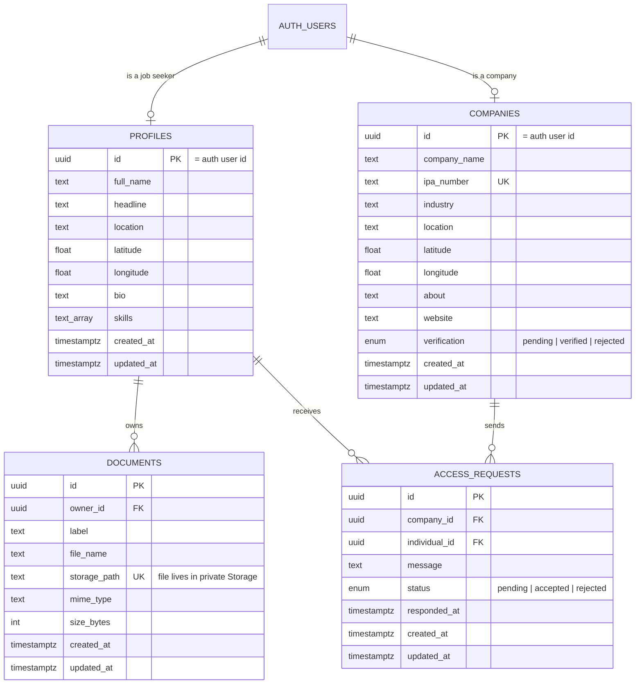
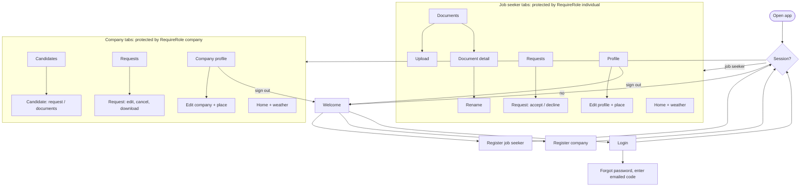

# Technical report: draft material

Handout section 8.2 wants a single PDF. The parts below are derived from the code and can be pasted
in and checked. **The build record and the reflection must be your own.**

## 1. Requirements (user stories)

| #   | Story                                                                                                         | Priority         |
| --- | ------------------------------------------------------------------------------------------------------------- | ---------------- |
| 1   | As a job seeker, I want to register and sign in, so that my profile and CV are private to me.                 | Must-have        |
| 2   | As a job seeker, I want to upload, rename and delete my CV, so that it is current.                            | Must-have        |
| 3   | As a job seeker, I want to accept or decline a company's request, so that I control who sees my documents.    | Must-have        |
| 4   | As a company, I want to register with my IPA number, so that candidates know I am a legitimate employer.      | Must-have        |
| 5   | As a verified company, I want to browse candidates and request their documents, so that I can shortlist them. | Must-have        |
| 6   | As a company, I want to edit or cancel a pending request, so that I can correct a mistake.                    | Must-have        |
| 7   | As a company, I want to download a CV only after the candidate accepts, so that the process respects consent. | Must-have        |
| 8   | As a user, I want to reset a forgotten password, so that I can regain access.                                 | Must-have        |
| 9   | As a user, I want to see the weather for my location, so that I can plan interviews and travel.               | Should-have      |
| 10  | As a company, I want candidates sorted by distance, so that I can find nearby people first.                   | Should-have      |
| 11  | As a user, I want to see my last-loaded lists when offline, so that the app is usable on a poor connection.   | Should-have      |
| 12  | As a job seeker, I want my CV split into several per-document grants, so that I share only what I choose.     | Could-have (cut) |

## 2. Data model

Relationships: one job seeker owns many documents (1:N). Companies and job seekers are linked many
to many through `access_requests`; a partial unique index allows one open request per pair.
Row Level Security: a job seeker's rows are visible only to them; a verified company can read job
seeker profiles; a company can read a candidate's `documents` rows and Storage files only while an
`accepted` request exists (`has_accepted_access`). The IPA number and verification status cannot be
changed from the app (`protect_company_fields` trigger).

## 3. Screen flow

The authentication boundary is `RequireRole`, used by each protected layout, plus the redirect in
`(auth)/_layout.tsx`. Even if someone forces navigation state, the database returns no rows.

## 4. API integration table

| Provider             | Endpoints / calls                                                                             | Data used for                                              | Limits                                 | When it fails                                                                  |
| -------------------- | --------------------------------------------------------------------------------------------- | ---------------------------------------------------------- | -------------------------------------- | ------------------------------------------------------------------------------ |
| Open-Meteo Forecast  | `GET api.open-meteo.com/v1/forecast`                                                          | Current weather and 5-day forecast for the coordinates     | Free tier, fair-use (HTTP 429 if busy) | Card shows a readable message and a "Try again" button; 15 s timeout           |
| Open-Meteo Geocoding | `GET geocoding-api.open-meteo.com/v1/search`                                                  | Place name to coordinates; saved location sorts candidates | Same                                   | Inline error with tap-to-retry; "No places found" empty state                  |
| expo-location        | `requestForegroundPermissionsAsync`, `getCurrentPositionAsync`, `reverseGeocodeAsync`         | Device position, rounded to about 1 km, and a place name   | Device permission                      | Permission denied or services off: message, and place search still works       |
| Supabase Auth        | `signUp`, `signInWithPassword`, `signOut`, `resetPasswordForEmail`, `verifyOtp`, `updateUser` | Accounts and session                                       | Email rate limits                      | Mapped to plain-language messages; session is restored from AsyncStorage       |
| Supabase Postgres    | `profiles`, `companies`, `documents`, `access_requests` via PostgREST                         | All app data                                               | RLS on every table                     | Cached lists shown with a "could not refresh" notice; retry on pull-to-refresh |
| Supabase Storage     | `upload`, `createSignedUrl`, `remove` on the private `documents` bucket                       | CV files                                                   | 5 MB per file; PDF and Word only       | Upload cleaned up if the record insert fails; readable error with retry        |

## 5. Build record (complete this yourself)

| Artefact | Profile      | EAS build ID | Result |
| -------- | ------------ | ------------ | ------ |
| APK      | `preview`    | `<paste>`    | `<>`   |
| AAB      | `production` | `<paste>`    | `<>`   |

Add a screenshot of the EAS dashboard showing both builds succeeded, and note every configuration
change you needed to make the compiled build work (for example creating the EAS environment
variables).

## 6. Reflection (500 to 800 words, yours alone)

Cover what you built, what broke, what you cut and why, what you would do differently, and what you
learned. The handout marks this; it is not a formality.
